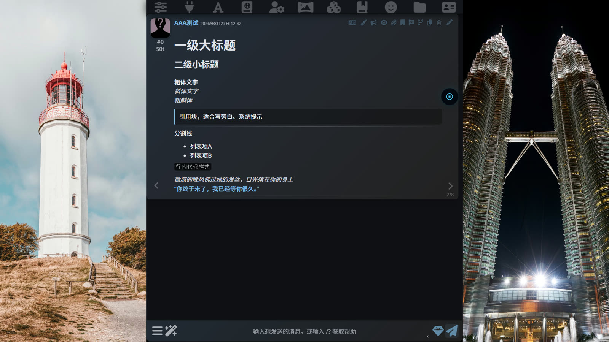

# 双屏背景氛围 · SillyTavern 全局脚本

> 酒馆界面左右两侧各一个循环媒体位，支持视频与图片混排，内置「电影控制室」暗色主题。

<!-- SCREENSHOT -->
<p align="center">
  
</p>
<!-- /SCREENSHOT -->

## 功能特性

- 左右两侧独立视频/图片背景，共享同一份媒体列表
- 支持格式：MP4 视频 + PNG / JPG / WebP / GIF 图片混排
- 独立控制面板（左下角 / 右下角 ⏻）：播放/暂停、上下切换、循环模式、音量、亮度
- 区域宽度 & 透明度可调，支持一键同步到另一侧
- 视频开关（带呼吸脉动提示），面板互斥防重叠
- 切后台自动暂停，回来恢复
- 所有设置自动保存至 localStorage
- 内置「电影控制室」主题（Playfair Display + JetBrains Mono）
- 兼容酒馆助手全局脚本 & 油猴（Tampermonkey）

## 安装

**方式一：酒馆助手（推荐）**

1. 从[最新 Release](https://github.com/Civinar-Riley/st-dual-ambience/releases/latest) 下载 `st-dual-ambience.tavern-helper.json`
2. 酒馆 → 酒馆助手 → **脚本库** → **全局脚本** → 工具栏 **导入** → 选择该 JSON → 启用脚本 → **F5 刷新**
3. 也可新建脚本并粘贴 `st_dual_ambience.js` 全部内容（效果相同）
4. 默认列表为公开演示图片，开箱即用

**方式二：油猴（Tampermonkey）**

1. Tampermonkey → 添加新脚本 → 粘贴 `st_dual_ambience.js` 全部内容
2. 把头部 `@match` 改成你的酒馆地址（默认 `http://localhost:8000/*`）→ 保存刷新

## 快速上手

| 操作 | 方法 |
|------|------|
| 打开面板 | 点击屏幕左下角或右下角的 ⏻ 按钮 |
| 添加媒体 | 面板内粘贴 URL → 回车或点「添加」 |
| 左右不同内容 | 两侧面板各自选择列表中的不同项 |
| 恢复默认 | 面板内点「↺ 恢复默认」 |
| 彻底重置 | F12 控制台执行 `localStorage.removeItem('st-lr-video-bg-v3')` 后刷新 |

## 文件结构

```
├── st_dual_ambience.js    # 主脚本（酒馆助手全局脚本，含油猴头）
├── 操作说明.md            # 用户操作指南
├── package.json           # 项目元信息与 npm scripts（无依赖）
├── test/                  # 精简测试页（模拟酒馆助手 iframe 环境）
│   ├── index.html         # 宿主页：打开即运行，含回归检查单
│   ├── env.html           # 执行环境 iframe：加载主脚本
│   └── assets/demo.mp4    # 本地走带测试视频（ffmpeg 生成）
├── screenshots/           # 效果截图
└── README.md
```

## 本地测试

```bash
npm run serve        # 等价 python -m http.server 8123
npm test             # node --check 语法检查
```

浏览器打开 `http://localhost:8123/test/`，按页内检查单回归。测试页拓扑与酒馆助手一致：脚本在 `test/env.html` 的 iframe 中执行，通过 `window.parent.document` 操作宿主 `test/index.html`。

## 许可证

本项目采用 [CC BY-NC-SA 4.0](LICENSE) 协议。

## 注意

本脚本针对 **PC 端窄屏**（页面宽度约 50%）优化设计。移动端或超宽屏下效果可能不理想，可通过面板内宽度/透明度滑条自行调节。

---

# Dual-Screen Background Ambience · SillyTavern Global Script

> A looping media slot on each side of the SillyTavern interface, supporting mixed video & image playback with a built-in "Cinema Control Room" dark theme.

<!-- SCREENSHOT -->
<p align="center">
  
</p>
<!-- /SCREENSHOT -->

## Features

- Independent video/image backgrounds on left & right sides, sharing one media list
- Supported formats: MP4 video + PNG / JPG / WebP / GIF images mixed in one list
- Independent control panels (bottom-left / bottom-right ⏻): play/pause, prev/next, loop mode, volume, brightness
- Adjustable region width & opacity, with one-click sync to the other side
- Power toggle (with breathing pulse indicator), mutually exclusive panels to prevent overlap
- Auto-pause when tab goes to background, auto-resume on return
- All settings saved to localStorage automatically
- Built-in "Cinema Control Room" theme (Playfair Display + JetBrains Mono)
- Compatible with SillyTavern Assistant global scripts & Tampermonkey

## Installation

**Option A: SillyTavern Assistant (recommended)**

1. Download `st-dual-ambience.tavern-helper.json` from the [latest release](https://github.com/Civinar-Riley/st-dual-ambience/releases/latest)
2. SillyTavern → SillyTavern Assistant → **Script Library** → **Global Scripts** → toolbar **Import** → select the JSON → Enable → **F5 Refresh**
3. Alternatively, create a new script and paste the entire content of `st_dual_ambience.js` (equivalent)
4. Default list contains public demo images — works out of the box

**Option B: Tampermonkey**

1. Tampermonkey → Create a new script → paste the entire content of `st_dual_ambience.js`
2. Edit the `@match` header to your tavern address (defaults to `http://localhost:8000/*`) → Save & refresh

## Quick Start

| Action | How |
|--------|-----|
| Open panel | Click the ⏻ button at bottom-left or bottom-right |
| Add media | Paste URL in the panel → press Enter or click "Add" |
| Different content per side | Select different items from the list in each panel |
| Reset to default | Click "↺ Restore Default" in the panel |
| Full reset | F12 console: `localStorage.removeItem('st-lr-video-bg-v3')` then refresh |

## File Structure

```
├── st_dual_ambience.js    # Main script (Tavern Assistant global script, with userscript header)
├── 操作说明.md            # User guide (Chinese)
├── package.json           # Project metadata & npm scripts (zero dependencies)
├── test/                  # Minimal test page (simulates the Tavern Assistant iframe environment)
│   ├── index.html         # Host page with a regression checklist
│   ├── env.html           # Execution iframe: loads the main script
│   └── assets/demo.mp4    # Local transport-control test clip (ffmpeg-generated)
├── screenshots/           # Preview screenshots
└── README.md
```

## Local Testing

```bash
npm run serve        # equivalent to python -m http.server 8123
npm test             # node --check syntax check
```

Open `http://localhost:8123/test/` and follow the on-page checklist. The test page mirrors the Tavern Assistant topology: the script runs inside the `test/env.html` iframe and touches the host `test/index.html` via `window.parent.document`.

## License

This project is licensed under [CC BY-NC-SA 4.0](LICENSE).

## Note

This script is optimized for **PC with a narrow layout** (page width ~50%). On mobile or ultra-wide screens, adjust the width/opacity sliders in the panel to suit your setup.
